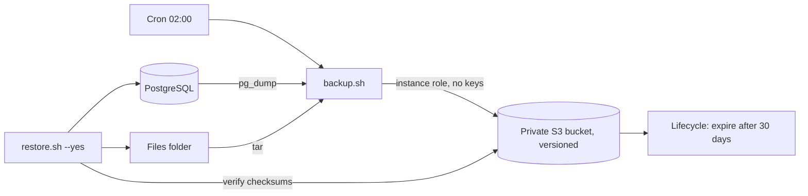

# aws-backup-s3

**Goal:** Back up a PostgreSQL database and a folder of files to a private, versioned S3 bucket, with checksums, a retention rule, a nightly schedule and a tested restore.

## Architecture

## What it does
- Dumps the database and archives the files, then uploads both with a SHA256 checksum file
- Uses an IAM role limited to the backups/ prefix (read and write, no delete), so no access keys are stored on the server
- The bucket is private and versioned, and a lifecycle rule expires backups after 30 days
- The restore verifies the checksums before replacing any data
- Tested by deleting a file and dropping a table, then restoring both

## Setup
1. Create a private, versioned bucket with a lifecycle rule, and a limited IAM role attached to the server
2. `cp .env.example .env` and fill in the values
3. `docker compose up -d`
4. `sudo ./scripts/backup.sh`, then `sudo ./scripts/restore.sh --yes` to test

## Screenshots

## Notes
- A backup is trusted only after a restore has been tested
- The database is bound to 127.0.0.1, so it is not reachable from outside
- For RDS, use RDS snapshots or the managed AWS Backup service instead of pg_dump
